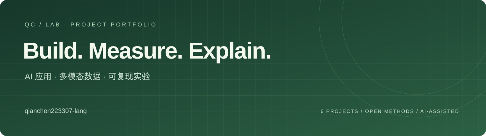

# qianchen223307-lang

关注把数据、算法和研究接口整理成可运行、可检查、能解释结果的作品。这里集中展示六个新建项目，覆盖应用开发、机器学习、优化算法、机器人工程工具与统计评估。

**作品集关键词：** Python 3.12 · 真实数据分析 · 约束优化 · 多模态数据质检 · 实验可复现

## 作品导航

| 方向 | 项目 | 本仓库的实质内容 | 入口 |
|---|---|---|---|
| 应用与优化 | [Charge Insight](https://github.com/qianchen223307-lang/charge-insight) | UrbanEV 容量口径校验、16 区域逐时预测、三方法对照与误差复核 | [交互演示](https://qianchen223307-lang.github.io/charge-insight/) |
| 应用与优化 | [SmartCharge Lab](https://github.com/qianchen223307-lang/smartcharge-lab) | FIFO 与两阶段线性规划、CSV 导入、功率/时间/电量约束验证 | [交互演示](https://qianchen223307-lang.github.io/smartcharge-lab/) |
| 机器人与数据 | [OpenViTac Data Audit](https://github.com/qianchen223307-lang/openvitac-data-audit) | ACT HDF5 分块读取、逐字段诊断、图像与动作预览 | [交互演示](https://qianchen223307-lang.github.io/openvitac-data-audit/) |
| 机器人与数据 | [VLA Data Preflight](https://github.com/qianchen223307-lang/vla-data-preflight) | LIBERO/OFT 配置、元信息、模态切片和数组快照交叉检查 | [交互演示](https://qianchen223307-lang.github.io/vla-data-preflight/) |
| 实验与研究 | [Embodied Eval Lab](https://github.com/qianchen223307-lang/embodied-eval-lab) | 逐回合日志校验、Wilson 区间、宏平均与严格配对比较 | [交互演示](https://qianchen223307-lang.github.io/embodied-eval-lab/) |
| 实验与研究 | [Data Efficient Learning Lab](https://github.com/qianchen223307-lang/data-efficient-learning-lab) | digits 样本预算实验、唯一代表选样、准确率与端到端耗时对照 | [交互演示](https://qianchen223307-lang.github.io/data-efficient-learning-lab/) |

## 从结果看作品

**预测：保留简单基线胜出的结果。** 在固定时间划分上，充电占用率下一小时预测的 Persistence 测试 MAE 为 **1.0682 个百分点**，HGB 为 **1.6461 个百分点**。项目报告实际对照，而不是默认更复杂的模型更好。区域容量按同区站点求和后归一化，保留源版本与数据哈希。

**优化：先保障供电，再比较费用和峰值。** 合成的 Solar-shaped 场景中，同等供电量下，FIFO → LP 的费用为 **96.574 → 56.250**，峰值为 **100 → 74.962 kW**；不可满足场景保留需求缺口。六份演示计划均通过独立约束检查。这是简化模型中的实验，不能直接视为真实场站收益。

**学习：计入选样成本。** digits 实测中，400 个聚类代表样本的平均准确率 **94.93%**，随机选样 **93.07%**；总耗时分别约 **260.36 ms** 与 **9.60 ms**。全量 1,347 个训练样本为 **96.22% / 27.09 ms**。聚类的选择成本明显，结论与原始试次一起公开。

**工程：让错误能够被定位。** 多模态与 VLA 工具提供正常/损坏样例、机器可读报告、CLI 退出码及回归检查。具身评估演示使用明确标记的合成逐回合日志，展示统计分析能力。

## 可核验能力

| 能力 | 对应证据 |
|---|---|
| 数据口径与时间序列处理 | 数据来源哈希、区域容量校验、时间切分和逐区域预测 CSV |
| 数学建模与优化 | 稀疏两阶段 LP、独立可行性检查、不可满足需求报告 |
| 研究接口工程化 | 固定上游版本、受限格式适配、HDF5 / YAML / NPZ 检查 |
| 实验设计与统计 | 固定数据划分、五个种子、135 次学习计时、成功率区间和配对条件 |
| 软件交付 | 六个 Python 包、命令行、依赖锁、77 项本地通过的测试、GitHub Actions 工作流 |

各仓库 README 均提供 Python 3.12 安装与复跑命令、来源、输入契约和结果边界。测试数量属于本地验证；远程工作流状态以各仓库 Actions 记录为准。

## AIforGreen 相关作品

报名能力展示可优先查看 [充电需求洞察](https://github.com/qianchen223307-lang/charge-insight) 与 [充电调度沙盒](https://github.com/qianchen223307-lang/smartcharge-lab)。两者是赛前通用准备与能力展示，正式比赛作品需按现场赛题与时间要求另行完成。

## 研究来源与边界

研究参考包括 [yifanwu-victor](https://github.com/yifanwu-victor)、[OpenViTac](https://fvl-repo.github.io/OpenViTac/)、[StarVLA](https://github.com/starVLA/starVLA)、[Spatial-Forcing](https://github.com/OpenHelix-Team/Spatial-Forcing)，数据来自 [UrbanEV](https://github.com/IntelligentSystemsLab/UrbanEV) 与 [UCI digits](https://archive.ics.uci.edu/dataset/80/optical+recognition+of+handwritten+digits)。展示导航参考了 [ton242678-glitch](https://github.com/ton242678-glitch) 的组织方式。

本次项目使用 **AI 辅助实现、调试与文档整理**。各项目独立实现并披露来源；没有将上游论文成绩、作者经历或真机实验作为本账号成果。机器人项目展示数据/评估工具，不代表完成大模型训练或真实机器人部署。

---

**English:** An AI-assisted portfolio of six runnable projects in applied ML, constrained optimization, multimodal data engineering and reproducible evaluation. Public observations, synthetic demonstrations and measured experiments are identified explicitly. Source code, data contracts and limitations are documented per project.
